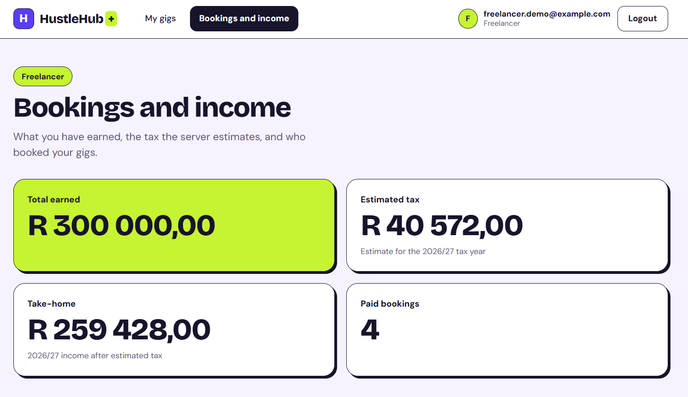
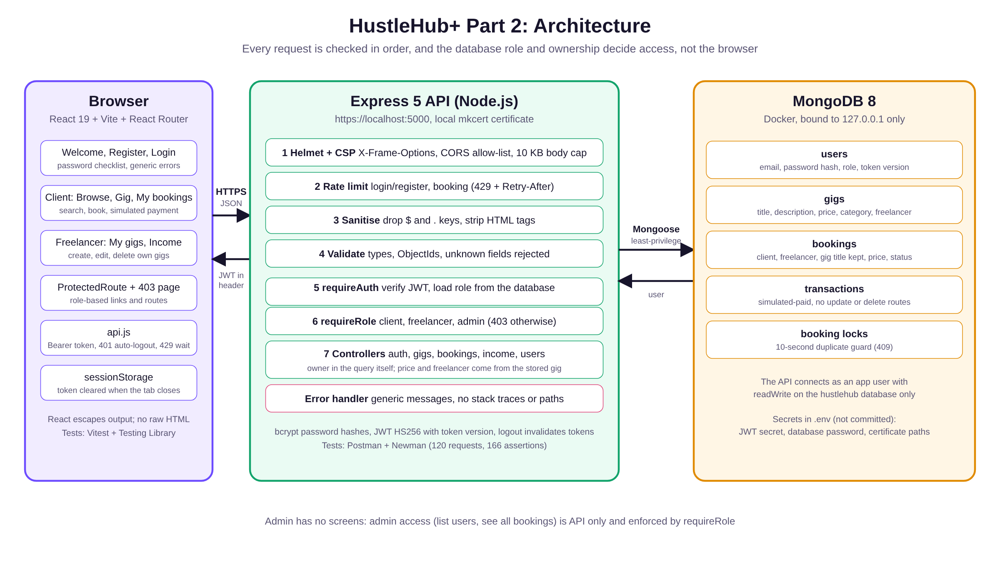

# HustleHub+

**Final POE: DevSecOps, Monitoring and Finalisation**

HustleHub+ is a secure freelance marketplace. Freelancers advertise services as **gigs**, clients **browse and book** them, and every booking creates a **simulated transaction** that feeds the freelancer's income. Security is treated as the main concern, not an add-on: every route is authenticated, access depends on role and ownership, all input is validated and sanitised, and the API is rate limited and served over HTTPS.

## Submission details

| | |
| --- | --- |
| Module | INSY7314 (Application Development Security), The Independent Institute of Education |
| Group | Group 2 |
| Submission | Final POE: DevSecOps, Monitoring and Finalisation, Monday 9 November 2026 |
| Final POE demo video | https://youtu.be/KpMu77Uqex8 |
| Part 2 submission | Secure Stack, Monday 12 October 2026 |
| Part 2 demo video | https://youtu.be/5EMVoo-9elM |
| Part 1 demo video | https://m.youtube.com/watch?v=1eZ9vMBlxWE&ra=m |

Built by a team of four: Funi, Nomsa, Kwethukubonga and Tlhogi (Letlhogonolo).

## Contents

1. [Features by role](#features-by-role)
2. [Tax estimation](#tax-estimation)
3. [Income dashboard](#income-dashboard)
4. [Architecture](#architecture)
5. [Security measures](#security-measures)
6. [Threat model](#threat-model)
7. [API endpoints](#api-endpoints)
8. [Environment variables](#environment-variables)
9. [Running the project](#running-the-project)
10. [Running with Docker](#running-with-docker)
11. [Testing](#testing)
12. [CI/CD pipeline](#cicd-pipeline)
13. [Static code analysis](#static-code-analysis)
14. [Logging and monitoring](#logging-and-monitoring)
15. [Extra security features](#extra-security-features)
16. [Security review](#security-review)
17. [Evidence](#evidence)
18. [Design decisions and trade-offs](#design-decisions-and-trade-offs)
19. [What changed in the final POE](#what-changed-in-the-final-poe)
20. [What changed from Part 1](#what-changed-from-part-1)
21. [AI declaration](#ai-declaration)
22. [References](#references)

## Features by role

| Role | What they can do |
| --- | --- |
| Visitor (not logged in) | See the welcome page, register, log in |
| Client | Browse and search gigs, open a gig, book it (simulated payment), see their own bookings and transaction references |
| Freelancer | Create, view, edit and delete their own gigs, see bookings made on their gigs, see income calculated by the server from transaction records |
| Admin | List all users and see all bookings through the API. Admin accounts cannot be registered: they are created by `npm run seed:admin`. The React app has no admin screens. |

Payments are **simulated**. A booking is confirmed immediately and a transaction record is created, linked to both the client and the freelancer. No money moves.

## Tax estimation

Freelancers see an estimate of the income tax they may owe on their HustleHub+ earnings for the current South African tax year. The estimate is calculated **on the server** from the freelancer's own transaction records. The browser never sends an amount to be taxed, so tampering with a request cannot change the result.

### Where the code lives

| File | Purpose |
| --- | --- |
| `api/src/config/taxConfig.js` | SARS brackets and rebate for the 2026/27 tax year, with the source in a comment |
| `api/src/services/taxService.js` | Pure calculation functions with no database access, so they can be unit tested on their own |
| `api/src/controllers/incomeController.js` | `GET /api/income`: loads the logged-in freelancer's transactions for the tax year and adds the tax summary to the response |
| `api/test/taxService.test.js` | Unit tests for the tax logic (see [API unit tests](#api-unit-tests-node-test-runner)) |

### Rules used

The figures are SARS's rates of tax for individuals for the tax year 1 March 2026 to 28 February 2027, which SARS calls the 2027 tax year and the app labels `2026/27` (South African Revenue Service, 2026).

| Taxable income (R) | Tax |
| --- | --- |
| 0 – 245 100 | 18% of taxable income |
| 245 101 – 383 100 | 44 118 + 26% of the amount above 245 100 |
| 383 101 – 530 200 | 79 998 + 31% of the amount above 383 100 |
| 530 201 – 695 800 | 125 599 + 36% of the amount above 530 200 |
| 695 801 – 887 000 | 185 215 + 39% of the amount above 695 800 |
| 887 001 – 1 878 600 | 259 783 + 41% of the amount above 887 000 |
| 1 878 601 and above | 666 339 + 45% of the amount above 1 878 600 |

The primary rebate of R17 820 is then subtracted. Tax can never be negative, so income of R99 000 or less (the tax threshold for someone under 65) gives an estimate of R0.

### Which income is taxed

SARS taxes income per tax year, so the estimate is based on **`taxYearIncome`**: only `simulated-paid` transactions dated from 1 March 2026 up to, but not including, 1 March 2027. The existing `total` field is unchanged and still shows all-time income. The two can differ, and the dashboard labels them separately.

### How the calculation works

1. The controller loads the freelancer's earned transactions for the tax year. The query is scoped to `req.user.id` from the verified token, and it fetches only `amount` and `createdAt`.
2. `taxService` adds up the amounts. Any negative or non-numeric amount is skipped.
3. It finds the bracket that the total falls into.
4. Tax before rebate = bracket base + bracket rate × (income − the bottom of that bracket).
5. Estimated tax = tax before rebate − R17 820, with a minimum of R0.
6. Net = `taxYearIncome` − estimated tax.
7. For the monthly chart, income is grouped by month from March to February, and the annual tax is split across the months in proportion to each month's income. The monthly tax values therefore add up to the annual figure.

### What `GET /api/income` returns

The existing fields (`currency`, `total`, `count`, `recent`) are unchanged. The tax fields are added next to them:

| Field | Meaning |
| --- | --- |
| `taxYear` | `"2026/27"` |
| `taxYearIncome` | Income earned in the tax year, in rands |
| `estimatedTax` | Estimated tax after the primary rebate, in rands |
| `net` | `taxYearIncome − estimatedTax` |
| `taxBeforeRebate`, `rebate` | The working, so the figure can be checked |
| `marginalRate`, `effectiveRate` | The bracket rate, and estimated tax ÷ income |
| `threshold`, `belowThreshold` | R99 000, and whether the freelancer is at or below it. The dashboard uses this to explain an R0 estimate instead of showing a bare zero |
| `monthly` | Twelve entries, `{ month, total, count, estimatedTax }`, from `2026-03` to `2027-02` |
| `assumptions`, `source` | The assumptions below and the SARS source, returned with every response |

### Worked example

A freelancer earns **R300 000** in the tax year.

1. R300 000 falls in the 26% bracket (R245 101 – R383 100).
2. Tax before rebate = R44 118 + 0.26 × (R300 000 − R245 100) = R44 118 + R14 274 = **R58 392**.
3. Estimated tax = R58 392 − R17 820 = **R40 572**.
4. Net = R300 000 − R40 572 = **R259 428**.
5. Effective rate = R40 572 ÷ R300 000 = **13.5%**.

The same case is a unit test (`worked example: R300 000`), so the README and the code cannot quietly disagree. It was also checked in the running app: a freelancer with four bookings of a R75 000 gig (R300 000 in November 2026) gets `taxBeforeRebate: 58392`, `estimatedTax: 40572`, `net: 259428` and an effective rate of 13.52% from `GET /api/income`, and the income dashboard shows the same figures.



Most demo accounts earn well below R99 000, so their estimate is correctly R0. The dashboard says the income is below the tax threshold rather than showing an unexplained zero.

### Assumptions and limits

- HustleHub+ income is treated as the freelancer's only taxable income.
- No deductions are applied (business expenses, retirement contributions, medical credits).
- Only the primary rebate is applied. HustleHub+ does not store users' ages, which is a deliberate data-minimisation choice, so the age-based secondary rebate (65 and older) and tertiary rebate (75 and older) are left out.
- Provisional tax payment dates and penalties are not modelled.
- This is an estimate to help freelancers plan, not tax advice.

### Security of the tax feature

- `GET /api/income` requires a valid JWT and the `freelancer` role. A client gets 403 and a request without a token gets 401.
- The query is scoped to the logged-in freelancer inside the database query, so one freelancer can never see another's income or tax.
- Every figure is calculated on the server from stored transactions. No amount from the request is used.
- The calculation rejects negative, non-numeric and infinite income instead of producing a misleading number.
- The SARS figures sit in one frozen configuration object, so updating them for a new tax year is a one-file change that the unit tests then check.

## Income dashboard

The **Bookings and income** page (`/income`, freelancers only) turns the freelancer's transactions into a short financial summary. Every amount comes from `GET /api/income`, which the server calculates from that freelancer's own transactions. The browser only displays those amounts and works out percentages and chart heights from them, so it cannot change what a freelancer earned or owes.

| Part of the page | What it shows | Field from the API |
| --- | --- | --- |
| Total earned | Everything earned since the account began | `total` |
| Estimated tax | The tax estimate for the current tax year, explained under [Tax estimation](#tax-estimation) | `estimatedTax`, `taxYear` |
| Take-home | This tax year's income after the estimated tax | `net` |
| Paid bookings | The number of paid transactions | `count` |
| Income per month chart | One column per month, from March to the current month, with the best month named above it | `monthly` |
| Income against tax bar | This tax year's income split into take-home and estimated tax | `taxYearIncome`, `net`, `estimatedTax` |

**Total earned is all-time, while tax and take-home cover the current tax year,** because SARS taxes one tax year at a time. Total earned can therefore be higher than the income the tax is worked out on.

**Accessibility.** The charts are drawn with plain HTML and CSS, so no chart library is added and the Content Security Policy does not need loosening. Each column and each part of the bar shows its value on hover and on keyboard focus, has a screen reader label, and **Show the numbers** opens the monthly figures as a table.

**Other states.** The page shows a loading message, an error notice with a **Try again** button, and a **No income yet** message before the first paid booking. Below the tax threshold the estimated tax is R 0,00 and the bar says that no tax is estimated.

The code is in `client/src/pages/IncomePage.jsx`, `client/src/components/IncomeChart.jsx`, `client/src/components/TaxSplitBar.jsx` and `client/src/incomeChart.js`.

## Architecture

```
Browser (React 19 + Vite, React Router)
        |  HTTPS, JSON, Authorization: Bearer <JWT>
        v
Express API (Node.js)  --  helmet, CORS, rate limiting, sanitise, validate, JWT, RBAC
        |  Mongoose, least-privilege database user
        v
MongoDB 8 (Docker, bound to 127.0.0.1)
```



| Part | Technology | Folder |
| --- | --- | --- |
| Frontend | React, Vite, React Router, Vitest and Testing Library | `client/` |
| Backend | Node.js, Express 5, Mongoose, JWT, bcrypt, winston | `api/` |
| Database | MongoDB 8 in Docker | `docker-compose.yml` |
| API tests | Postman collection run with Newman | `postman/` |
| Pipeline | GitHub Actions | `.github/workflows/ci.yml` |

Request flow for a protected route: `helmet` and CORS, JSON body parser (10 KB cap), sanitiser, rate limiter (on sensitive routes), `requireAuth` (verifies the JWT and loads the user), `requireRole`, validation rules, then the controller.

## Security measures

| Measure | Why | Where in the code |
| --- | --- | --- |
| Passwords hashed with bcrypt, never stored in plain text | A database leak must not reveal passwords | `api/src/controllers/authController.js` |
| Password policy: at least 12 characters, upper and lower case, a number and a symbol, at most 72 bytes (bcrypt's limit) | Makes guessing harder, and avoids silent truncation | `api/src/middleware/validators.js`, mirrored in `client/src/passwordRules.js` |
| JWT signed with HS256 only, secret from environment, at least 32 characters, checked at startup | Stops algorithm-downgrade tokens and weak secrets | `api/src/middleware/auth.js`, `api/src/config/env.js` |
| The user is loaded from the database on every request, so the **role always comes from the database**, not the token | A changed role or deleted account takes effect immediately | `api/src/middleware/auth.js` |
| Token versioning: logging out, or changing the password, invalidates earlier tokens | A stolen token stops working after logout or a password change | `api/src/middleware/auth.js`, `authController.js`, `passwordController.js` |
| Role-based access control on every protected route | Each role only reaches its own features | `api/src/middleware/` (`requireRole`), route files in `api/src/routes/` |
| Ownership enforced inside the query (`findOneAndUpdate({ _id, freelancer: req.user.id })`) | Stops users editing or deleting each other's gigs; someone else's gig returns 404, the same as a missing one, so ids cannot be probed | `api/src/controllers/gigController.js` |
| Booking price and freelancer are read from the gig in the database, never from the request body | A client cannot change what they pay or who gets paid | `api/src/controllers/bookingController.js` |
| A booking always has a transaction; transactions have no update or delete routes | Financial records stay consistent and append-only | `api/src/controllers/bookingController.js`, `api/src/models/Transaction.js` |
| Duplicate booking guard (same client and gig within 10 seconds returns 409) | A double click or retry cannot charge twice | `api/src/models/BookingLock.js` |
| Registration accepts only `client` or `freelancer` (field whitelist) | No self-assigned admin | `api/src/middleware/validators.js`, `api/src/models/User.js` |
| Input validation: types, ranges, valid ObjectIds, only expected fields read | Rejects malformed and malicious input before it reaches the database | `api/src/middleware/validators.js`, `gigValidators.js`, `bookingValidators.js` |
| Sanitisation: keys starting with `$` or containing `.` are dropped, HTML tags are stripped | Blocks NoSQL operator injection and script tags | `api/src/middleware/sanitise.js` |
| Search text must be a plain string of at most 100 characters and is regex-escaped | Stops `?q[$ne]=x` and regex-based attacks | `api/src/controllers/gigController.js` |
| Rate limiting: login and register share a limit of 10 attempts per 15 minutes per IP; booking is limited to 20 per IP in a 10-minute window. A 429 returns a JSON body and a `Retry-After` header | Slows brute force and abuse | `api/src/middleware/rateLimiters.js`, `api/src/config/env.js` |
| Helmet with a Content Security Policy: `default-src 'self'`, `object-src 'none'`, `frame-ancestors 'none'`, `base-uri 'self'`, plus HSTS, `nosniff`, `Referrer-Policy: no-referrer`, `X-Frame-Options: DENY` | Reduces XSS, clickjacking and content-sniffing risk | `api/src/app.js` |
| The containerised client is served by nginx, which sends its own CSP including `frame-ancestors 'none'` | A `<meta>` tag cannot express framing rules, so the built app is protected in a way the development server is not | `client/nginx.conf` |
| CORS restricted to the frontend origins in `CLIENT_ORIGIN`; `Retry-After` is exposed to the app | Other websites cannot read API responses | `api/src/app.js` |
| JSON body size capped at 10 KB | Stops oversized-payload abuse | `api/src/app.js` |
| Generic error responses (no stack traces or paths), JSON 404, clear message for malformed JSON | Does not leak internals | `api/src/middleware/errorHandler.js`, `api/src/app.js` |
| Login gives the same message, and takes about the same time, for an unknown email and a wrong password | Prevents user enumeration by response and by timing | `api/src/controllers/authController.js` |
| HTTPS with a local mkcert certificate | Encrypts traffic between the client and the API | `api/src/server.js`, `api/src/config/env.js` |
| Database user with `readWrite` on the `hustlehub` database only; MongoDB listens on 127.0.0.1 only | Limits what a compromised API could do | `api/scripts/createDbUser.js`, `docker/mongo-init.js`, `docker-compose.yml` |
| Containers run as non-root users and the certificates are mounted read only rather than built into an image | A container escape gains no root, and the private key never enters an image layer | `api/Dockerfile`, `client/Dockerfile`, `docker-compose.yml` |
| Startup checks fail fast with a clear message if secrets or certificates are missing | No insecure default configuration | `api/src/config/env.js` |
| React escapes all output; the code never uses `dangerouslySetInnerHTML`; fonts are bundled so a strict CSP needs no external hosts | Prevents XSS in the UI | `client/src/` |
| Frontend logs out automatically on any 401, and shows readable messages for 403, 409 and 429 | A rejected or expired token never leaves the user in a broken state | `client/src/api.js`, `client/src/AuthProvider.jsx` |

The route guards in the React app only improve the experience. **The real enforcement is on the server.**

## Threat model

| Threat | Control | File |
| --- | --- | --- |
| Broken access control (acting outside your role) | `requireRole` on every route, role read from the database | `api/src/middleware/auth.js`, route files |
| Insecure direct object reference (guessing gig or booking ids) | Ownership in the query, 404 for others' resources | `api/src/controllers/gigController.js` |
| Price or payee tampering on booking | Price and freelancer loaded from the gig | `api/src/controllers/bookingController.js` |
| NoSQL injection (`{"$ne": null}`, `?q[$ne]=x`) | Type validation, sanitiser, escaped search | `api/src/middleware/sanitise.js`, `validators.js`, `gigController.js` |
| Cross-site scripting | HTML stripped on input, React escaping, CSP | `api/src/middleware/sanitise.js`, `api/src/app.js`, `client/nginx.conf`, `client/src/` |
| Credential brute force | Rate limiting, strong password policy, generic login error | `api/src/middleware/rateLimiters.js`, `validators.js` |
| Token forgery or downgrade (`alg: none`) | HS256 only, secret checked at startup | `api/src/middleware/auth.js`, `api/src/config/env.js` |
| Use of a stolen token after logout | Token versioning | `api/src/middleware/auth.js` |
| Privilege escalation at registration | Role whitelist, admin created only by script | `api/src/middleware/validators.js` |
| Double charge from a double click | 10-second duplicate booking guard | `api/src/models/BookingLock.js` |
| Information disclosure through errors | Generic JSON errors, no stack traces | `api/src/middleware/errorHandler.js` |
| Oversized payloads | 10 KB body cap, 413 response | `api/src/app.js` |
| Cross-origin reads of API data | CORS allow-list | `api/src/app.js` |
| Clickjacking | `frame-ancestors 'none'`, `X-Frame-Options: DENY` | `api/src/app.js`, `client/nginx.conf` |
| Database exposure | Least-privilege user, localhost-only binding | `api/scripts/createDbUser.js`, `docker-compose.yml` |
| Vulnerable dependency reaching production | `npm audit` gate on production dependencies in the pipeline | `.github/workflows/ci.yml` |
| Insecure code reaching main | ESLint with the security plugin and Semgrep on every push | `.github/workflows/ci.yml`, `api/eslint.config.js` |

## API endpoints

All routes are under `https://localhost:5000`. Every route except register, login and health needs `Authorization: Bearer <token>`.

| Method | Path | Who | Notes |
| --- | --- | --- | --- |
| POST | `/api/register` | public | Role must be `client` or `freelancer`. Rate limited |
| POST | `/api/login` | public | Returns a token and the user. Rate limited |
| POST | `/api/logout` | any logged-in user | Invalidates earlier tokens |
| POST | `/api/change-password` | any logged-in user | Body: `currentPassword`, `newPassword`. Needs the current password, ends every other session and returns a fresh token. Rate limited |
| GET | `/api/profile` | any logged-in user | The caller's own details |
| GET | `/api/gigs` | client, admin | Browse. Query: `q`, `category`, `page`, `limit` |
| GET | `/api/gigs/mine` | freelancer | The caller's own gigs |
| GET | `/api/gigs/:id` | any logged-in user | One gig |
| POST | `/api/gigs` | freelancer | Fields: title, description, price, category |
| PUT | `/api/gigs/:id` | freelancer, owner only | 404 if the gig is not the caller's |
| DELETE | `/api/gigs/:id` | freelancer, owner only | 404 if the gig is not the caller's |
| POST | `/api/bookings` | client | Body: `gigId` only. Creates a booking and a transaction. Rate limited |
| GET | `/api/bookings` | client, freelancer, admin | Each role sees only its own bookings (admin sees all). Query: `page`, `limit` |
| GET | `/api/income` | freelancer | All-time totals plus tax-year income, estimated tax, net and a monthly breakdown, all calculated by the server from transactions. See [Tax estimation](#tax-estimation) |
| GET | `/api/users` | admin | Paged user list |
| GET | `/api/health` | public | Liveness check |

Error responses are JSON: `{ "error": "..." }`, or `{ "message": "Validation failed", "errors": [{ "field", "message" }] }` for validation.

## Environment variables

Real values are never committed. Copy each `.env.example` to `.env`.

**Repository root `.env`** (read by Docker Compose and `db:create-user`):

| Variable | Purpose |
| --- | --- |
| `MONGO_ROOT_USERNAME`, `MONGO_ROOT_PASSWORD` | MongoDB admin account, created when the container first starts |
| `MONGO_APP_USERNAME`, `MONGO_APP_PASSWORD` | The least-privilege account the API connects as |

**`api/.env`**:

| Variable | Purpose |
| --- | --- |
| `PORT` | API port (default 5000) |
| `CLIENT_ORIGIN` | Comma-separated list of allowed frontend origins, for example `http://localhost:5173` |
| `JWT_SECRET` | Token signing secret, at least 32 characters |
| `MONGO_URI` | `mongodb://<app user>:<app password>@127.0.0.1:27017/hustlehub?authSource=hustlehub` |
| `SSL_KEY_PATH`, `SSL_CERT_PATH` | Paths to the local HTTPS key and certificate (for example `./certs/localhost-key.pem` and `./certs/localhost.pem`) |
| `AUTH_RATE_LIMIT_WINDOW_MS`, `AUTH_RATE_LIMIT_MAX` | Login and register limiter (defaults: a 15-minute window, 10 attempts). The Postman suite needs `AUTH_RATE_LIMIT_MAX=50` |
| `BOOKING_RATE_LIMIT_WINDOW_MS`, `BOOKING_RATE_LIMIT_MAX` | Booking limiter (defaults: a 10-minute window, 20 bookings) |
| `LOCKOUT_MAX_ATTEMPTS`, `LOCKOUT_MINUTES` | Per-account login lockout: failed logins in a row before the account locks (default 5), and how long it stays locked (default 15 minutes) |
| `LOG_LEVEL` | `error`, `warn`, `info` (default) or `debug` |
| `LOG_SINK_URL`, `LOG_SINK_TOKEN` | Cloud logging platform URL (must start with `https://`) and source token. Leave both empty to log to the console only. Keep the token in `api/.env` and in a GitHub secret, never in the repository |
| `ADMIN_EMAIL`, `ADMIN_PASSWORD` | Read only by `npm run seed:admin`. The password needs 12+ characters with upper and lower case, a number and a symbol. Never commit these |

**`client/.env`**:

| Variable | Purpose |
| --- | --- |
| `VITE_API_URL` | API address, for example `https://localhost:5000` |

## Running the project

### Prerequisites

Node.js, Docker Desktop, and [mkcert](https://github.com/FiloSottile/mkcert) for the local HTTPS certificate.

### 1. Certificate

```powershell
mkcert -install
```

Create the certificate inside `api/certs/` (this folder is git-ignored, so the private key is never committed) and point `SSL_KEY_PATH` and `SSL_CERT_PATH` at the two files:

```powershell
cd api
mkdir certs
mkcert -key-file certs/localhost-key.pem -cert-file certs/localhost.pem localhost 127.0.0.1
```

### 2. Database

```powershell
# repository root
Copy-Item .env.example .env       # then set your own MONGO_* passwords in .env
docker compose up -d mongo
```

Generate a strong password with:

```powershell
node -e "console.log(require('crypto').randomBytes(24).toString('base64url'))"
```

### 3. API

```powershell
cd api
Copy-Item .env.example .env       # set JWT_SECRET, SSL_KEY_PATH, SSL_CERT_PATH, MONGO_URI, ADMIN_EMAIL and ADMIN_PASSWORD
npm install
npm run db:create-user            # creates the least-privilege database user (once)
npm run seed:admin                # creates the admin account (once)
npm run dev
```

If the API refuses to start, it prints which setting is missing. `seed:admin` reads `ADMIN_EMAIL` and `ADMIN_PASSWORD` from `api/.env`. It never overwrites an existing account, so to change the admin, use a different email.

Open `https://localhost:5000` once in the browser and accept the certificate warning if it shows one.

### 4. Client

```powershell
cd client
Copy-Item .env.example .env
npm install
npm run dev
```

Open `http://localhost:5173`.

### Trying it out

1. Register a **freelancer** and a **client** (use two browser windows).
2. As the freelancer, create a gig under **My gigs**.
3. As the client, **Browse**, open the gig and **Book** it. A confirmation shows a booking reference and a transaction reference.
4. As the client, open **My bookings**. As the freelancer, open **Bookings and income**.

## Running with Docker

The whole stack runs in containers and is orchestrated by [`docker-compose.yml`](docker-compose.yml).

| Service | Image | Runs as | Published on | Image size |
| --- | --- | --- | --- | --- |
| `mongo` | `mongo:8` | `mongodb` | `127.0.0.1:27017` | |
| `api` | built from [`api/Dockerfile`](api/Dockerfile) on `node:22-slim` | `node`, uid 1000 | `127.0.0.1:5000` | 362 MB |
| `client` | built from [`client/Dockerfile`](client/Dockerfile) on nginx unprivileged | `nginx`, uid 101 | `127.0.0.1:8080` | 74.6 MB |

### Starting the stack

```powershell
# repository root, with .env and api/.env filled in and certificates in api/certs
docker compose up -d --build
```

The API is then on `https://localhost:5000` and the client on `http://localhost:8080`. Stop it with `docker compose down`, or `docker compose down -v` to discard the database volume as well.

The admin account is created inside the running API container:

```powershell
docker compose exec api npm run seed:admin
```

### What each container does

`mongo` stores the data in a named volume, so it survives a restart and is never written into the repository folder. On the very first start it runs [`docker/mongo-init.js`](docker/mongo-init.js), which creates the application database user with `readWrite` on the `hustlehub` database only. The root account is used for that one step and never by the application.

`api` runs the Express server over HTTPS. The image is multi-stage: dependencies are installed with `npm ci --omit=dev` in a build stage, and only `node_modules`, `package*.json`, `src` and `scripts` are copied into the runtime image, so no development tooling ships. It waits for the database to report healthy before starting.

`client` builds the Vite bundle in a Node stage and copies only the static output into an nginx image, which is why it is 74.6 MB against the API's 362 MB. nginx serves the built app and adds the security headers itself, from [`client/nginx.conf`](client/nginx.conf): a Content Security Policy, `X-Content-Type-Options`, `Referrer-Policy` and `X-Frame-Options: DENY`.

Neither application container runs as root. The API image runs as the `node` user that ships with the Node image, and the client uses `nginxinc/nginx-unprivileged`, which listens on 8080 as the `nginx` user rather than binding a privileged port as root.

### Certificates and configuration

The certificates are **mounted read only** from `api/certs` into the API container rather than copied into the image, so the private key never becomes part of a layer and never reaches a registry. `certs` is listed in `api/.dockerignore` for the same reason.

Compose reads the database credentials from the repository root `.env` and the rest of the API settings from `api/.env`, then overrides the values that have to differ inside containers:

| Variable | Value inside Compose | Why it differs |
| --- | --- | --- |
| `MONGO_URI` | points at the `mongo` service by name, as the application user | `127.0.0.1` inside a container is the container itself, not the database |
| `SSL_KEY_PATH`, `SSL_CERT_PATH` | `./certs/localhost-key.pem`, `./certs/localhost.pem` | Resolved inside the container against `/app`, where the folder is mounted |
| `CLIENT_ORIGIN` | `http://localhost:8080,http://localhost:5173` | The containerised client is served on 8080 |
| `NODE_ENV` | `production` | |
| `PORT` | `5000` | |

Every port is published to `127.0.0.1` rather than all interfaces, so nothing in the stack is reachable from other machines on the network.

### The running stack

The three containers up, the database health check passing, and the user each application container actually runs as:

Neither application container runs as root: the API answers as `node` (uid 1000) and the client as `nginx` (uid 101), which is what the Dockerfiles set. nginx also sends the security headers from [`client/nginx.conf`](client/nginx.conf) on the built app, including the `frame-ancestors 'none'` that a `<meta>` tag cannot express:

## Testing

### Frontend (Vitest and Testing Library)

```powershell
cd client
npm test                    # runs once and exits
npm run test:watch          # watch mode
npm run test:report         # runs once and also writes evidence/frontend-tests.xml (JUnit)
npm run lint
```

If the machine runs out of memory, limit the workers: `npm test -- --maxWorkers=2`.

**The suite has 18 test files with 80 tests, and all of them pass.** The JUnit results from the latest run are in [`evidence/frontend-tests.xml`](evidence/frontend-tests.xml).

The tests cover component rendering and user interaction: protected routes, the role-based header, the notice component, the welcome page, login, register and password rules, Browse (search, empty, loading and error states), gig detail and booking, My bookings, My gigs (create, edit, delete) and the income dashboard (the server's totals, estimated tax and take-home, the monthly chart on hover and keyboard focus, the tax split, the table view of the chart, and the empty, no-tax and sample-data states).

### API unit tests (Node test runner)

```powershell
cd api
npm run test:unit
```

**Result of the final run: 50 tests, all passing.**

**Tax calculation** (`api/test/taxService.test.js`), written with Node's built-in test runner, so no test framework is added to the API's dependencies:

- **Zero income and the threshold:** R0 and R99 000 give R0 tax, and R100 000 gives R180, which proves the primary rebate is applied.
- **Every bracket edge:** the top of each bracket (R245 100, R383 100, R530 200, R695 800, R887 000, R1 878 600) gives exactly the next bracket's base amount. This proves the table and the formula agree at every boundary. One rand over an edge moves into the next bracket.
- **The top bracket:** R2 000 000 is taxed at 45%.
- **The worked example:** R300 000 gives R58 392 before rebate, R40 572 estimated tax and R259 428 net, matching the [Tax estimation](#tax-estimation) section.
- **Invalid input:** negative, `NaN` and non-number income are rejected.
- **The monthly summary:** the tax year runs from March to February; income is grouped by month with a count; transactions from another tax year are ignored; invalid amounts are skipped; the monthly tax adds up to the annual figure; and an empty list returns zeros rather than an error.
- **Demo-sized income:** a small income gives R0 with `belowThreshold: true`, so the dashboard can explain the zero.

**Login lockout and logging:** 19 tests cover the lockout rules, the login behaviour (including constant-time login), log redaction and log-injection protection, and the cloud log transport, including that an unreachable platform never throws or blocks logging.

13 more tests cover the password change: a correct change works and ends older sessions, a wrong current password is refused and counted towards the lockout, a locked account cannot change its password, two changes at the same moment cannot both win, no password reaches the logs, the new password follows the same policy as registration, and the sanitiser leaves passwords exactly as typed.

### Backend (Postman and Newman)

The collection is in `postman/`. It covers successful flows and failure cases: 403 for the wrong role, 404 for another user's resource, 429 rate limiting, NoSQL injection attempts, and invalid input. The collection has six folders, in run order: Auth, Gigs, Bookings, Income, Roles and Admin, and Security.

`npm run test:api` in the `api` folder runs the collection with Newman against a running API, replacing the placeholder script from Part 2. It exits non-zero if any assertion fails, which is what allows the pipeline to fail on a broken API test.

Before a full run:

1. Set `AUTH_RATE_LIMIT_MAX=50` in `api/.env` and restart the API. The suite deliberately exhausts the login limiter at the end, so the limit must be above about 20.
2. Create the admin with `npm run seed:admin`, and generate an expired token: `node generate-expired-token.js` in `api`, then wait a couple of seconds.
3. Put the credentials in the shell session only, never in a file:

```powershell
$env:ADMIN_EMAIL = "<ADMIN_EMAIL from api/.env>"
$env:ADMIN_PASSWORD = "<ADMIN_PASSWORD from api/.env>"
$env:EXPIRED = "<token from generate-expired-token.js>"
New-Item -ItemType Directory -Force evidence | Out-Null
```

```powershell
newman run postman/HustleHub_Part2_Auth_Gigs.postman_collection.json --insecure --env-var "adminEmail=$env:ADMIN_EMAIL" --env-var "adminPassword=$env:ADMIN_PASSWORD" --env-var "expiredToken=$env:EXPIRED" -r "cli,htmlextra" --reporter-htmlextra-export evidence\newman-report.html
```

`--insecure` is needed because the API uses a locally generated certificate. The admin credentials are passed with `--env-var` so they are never stored in the collection. The `htmlextra` reporter is installed with `npm install -g newman newman-reporter-htmlextra`.

**Result of the final run: 124 requests, 176 assertions, 0 failed.** See [`evidence/newman-report.html`](evidence/newman-report.html).

The rate limiter counts in memory, so restart the API between full runs. Otherwise the limits from the previous run are still counted and the Auth and Admin steps fail with 429 or 401.

## CI/CD pipeline

The pipeline is defined in [`.github/workflows/ci.yml`](.github/workflows/ci.yml) and is triggered on **every push and every pull request**. It has four jobs.

| Job | What it does | Fails the run when |
| --- | --- | --- |
| Backend tests | Starts a MongoDB service container, runs the API unit tests, generates a throwaway certificate, seeds an admin, starts the API and runs the Postman collection with Newman | A unit test fails, the API does not start within 60 seconds, or any Newman assertion fails |
| Frontend tests | Installs the client, lints it, runs the Vitest suite and builds the production bundle | Lint reports an error, a test fails, or the build fails |
| Static analysis | Runs ESLint with the security plugin, `npm audit` and Semgrep over both applications and uploads the reports as a downloadable artifact | ESLint reports an error, or a production dependency has a high or critical advisory |
| Docker build and smoke test | Builds both images, starts the whole stack with Compose and calls the API health endpoint and the client | An image fails to build, or either service does not answer |

The Docker job declares `needs: [backend, frontend]`, so images are only built once the tests have passed. Runs on the same branch cancel each other, so only the newest commit is tested.

Every check is a hard gate: each step runs a command that exits non-zero on failure, and a non-zero exit fails the step, the job and the run. Newman exits 1 if a single assertion fails, which was confirmed by running the collection against a deliberately broken assertion. The only steps allowed to continue after a failure are the three that write the static analysis reports, so that the artifact is still uploaded; the checks they would otherwise hide run again afterwards as separate gating steps.

### Self-contained by design

The pipeline depends on no developer machine and no committed secret:

- the HTTPS certificate is generated with `openssl` inside the job and is valid for one day;
- the database is an ephemeral MongoDB service container, created and destroyed with the run;
- `JWT_SECRET` and `ADMIN_PASSWORD` come from the repository secrets `CI_JWT_SECRET` and `CI_ADMIN_PASSWORD` when they are set, and fall back to throwaway values so the pipeline also runs on a fork;
- the Docker job generates its database passwords with `openssl rand` into throwaway `.env` files;
- the certificate files are made world readable with `chmod 644`, because the API container runs as a non-root user that would otherwise be unable to read a key written by the runner.

Newman needs three values that are deliberately not stored in the collection: `adminEmail`, `adminPassword` and `expiredToken`. The job seeds the admin account, generates an expired token with `api/generate-expired-token.js`, and passes all three with `--env-var`, so no credential is ever written to a file in the repository and the token-expiry test always runs against a genuinely expired JWT. `AUTH_RATE_LIMIT_MAX` is set to 50 for the run, because the Security folder deliberately exhausts the login limiter at the end and the suite needs headroom above roughly 20. If a run fails, the job uploads `api/api.log` as an artifact so the API's own output can be read afterwards.

### Local verification

Every job was also reproduced locally with the same commands the workflow uses:

```powershell
cd api
npm ci
npm run test:unit        # 50 passed
npm run lint             # 0 errors
npm run seed:admin
npm run test:api -- --env-var "adminEmail=..." --env-var "adminPassword=..." --env-var "expiredToken=..."
                         # 124 requests, 176 assertions, 0 failed

cd ../client
npm ci
npm run lint             # 0 errors
npm test                 # 80 passed in 18 files
npm run build            # succeeds

cd ..
docker compose build     # both images build
docker compose up -d
curl.exe -sk https://localhost:5000/api/health   # 200
curl.exe -s  http://localhost:8080               # 200
docker compose down
```

## Static code analysis

Three tools run over both applications in the Static analysis job, and their reports are uploaded
as the `static-analysis-reports` artifact. The same reports were generated locally with the
commands the job uses and committed to [`evidence/`](evidence/):
[`static-analysis-summary.txt`](evidence/static-analysis-summary.txt),
[`eslint-api.json`](evidence/eslint-api.json), [`eslint-client.json`](evidence/eslint-client.json),
[`semgrep.json`](evidence/semgrep.json), [`npm-audit-api.json`](evidence/npm-audit-api.json) and
[`npm-audit-client.json`](evidence/npm-audit-client.json).

| Tool | Scope | Command |
| --- | --- | --- |
| ESLint with [`eslint-plugin-security`](https://github.com/eslint-community/eslint-plugin-security) | `api` | `npm run lint` in `api` |
| ESLint | `client` | `npm run lint` in `client` |
| `npm audit` | the dependencies of both applications | `npm audit` in each folder |
| Semgrep, rule sets `p/javascript` and `p/security-audit` | `api` and `client` | `semgrep --config p/javascript --config p/security-audit api client` |

Semgrep has no native Windows build, so it was run through its official Docker image to produce the committed report:

```powershell
docker run --rm -v "${PWD}:/src" -w /src semgrep/semgrep semgrep --config p/javascript --config p/security-audit --json --output evidence/semgrep.json --metrics off --exclude node_modules api client
```

### Semgrep results

101 rules over 116 files, **1 finding, no errors**. It is a warning rather than a vulnerability, and it was worth having:

| Finding | Where | What it means |
| --- | --- | --- |
| `generic.nginx.security.header-redefinition` | `client/nginx.conf:18` | The `/healthz` location sets its own `add_header`, and nginx then stops applying the server block's `add_header` directives to that location. The health endpoint therefore answers without the Content-Security-Policy, `X-Content-Type-Options`, `Referrer-Policy` and `X-Frame-Options` headers that every other response carries. It returns the fixed string `ok` and no user data, so nothing is exposed, but the headers should be consistent across the whole site. |

This is the kind of thing that is easy to miss by reading the configuration and easy for a scanner to catch, which is why Semgrep is in the pipeline alongside ESLint.

### ESLint results

ESLint reports **0 errors and 0 warnings** across 48 files in the API, and 0 across 52 files in the client.

`eslint-plugin-security` raised warnings in five places on the first full run. None was an exploitable vulnerability, but each was resolved rather than ignored:

| Finding | Where | Resolution |
| --- | --- | --- |
| Object injection sink | `src/middleware/sanitise.js`, `src/utils/logSanitiser.js`, `src/utils/logger.js`, `src/services/taxService.js` | Rewritten so the code no longer indexes an object with a variable key |
| Object injection sink | `src/config/env.js`, `scripts/createDbUser.js` | The key is a fixed setting name defined in the same file and never request data. Suppressed on that single line with a written reason |
| Non-literal regular expression | `src/controllers/gigController.js` | The search term is already type-checked, capped at 100 characters and regex-escaped before the pattern is built, so a pattern cannot be injected. No suppression needed |
| Non-literal filename in `readFileSync` | `src/server.js` | The certificate paths come from validated start-up configuration, never from a request. Suppressed for that block with a written reason |
| Object injection sink | `test/**` | Tests index objects with their own fixed keys. The rule is disabled for the test folder only, in [`api/eslint.config.js`](api/eslint.config.js) |

Nothing on the request path is suppressed: the sanitisation middleware, which is the one place that deliberately walks untrusted request objects, passes the security rules as written. Every suppression is a targeted `eslint-disable-next-line` or a scoped override carrying its reason, so none of them hides a future finding elsewhere in the file.

One ordinary error also came out of that run: a `catch (err)` block in `src/middleware/auth.js` bound an error it never used, which `no-unused-vars` rejects. It now uses an optional catch binding, `catch { ... }`.

### Dependency audit results

`npm audit` reports **0 vulnerabilities in the production dependencies** of both applications. Reaching that took three changes:

1. **Newman moved out of `devDependencies`** and is now invoked with `npx`. Pinning it had pulled in the Postman tool chain, which carried thirteen high and one critical advisory. The test runner is not part of the application, so it does not belong in its dependency tree.
2. **Express updated from 5.2.1 to 5.3.0.**
3. **`body-parser`, `qs` and `ip-address` updated** to patched versions, which cleared one high and two moderate advisories that would otherwise have shipped.

Five moderate advisories remain in the API's development dependencies and four in the client's. These are build and test tooling only. They are excluded from the failing gate with `--omit=dev`, because the production images are built with `npm ci --omit=dev` and never install them. They are still written to the uploaded report, so they are visible rather than hidden.

### Why the gate uses `--omit=dev`

Failing the build on any advisory anywhere would make the pipeline red for problems that cannot reach a user, and the usual response to that is to stop reading the output. The gate therefore fails only on what actually ships, while the full report, including development dependencies, is kept as an artifact for review.

## Logging and monitoring

The API writes one structured JSON log line for every important event, using [winston](https://github.com/winstonjs/winston) (`api/src/utils/logger.js`). Lines are printed to the console and, when a log platform is configured, sent to it as well, so the logs can be searched, filtered and alerted on instead of only read in a terminal. Every line has a timestamp, a level, an event name (`message`) and a few fields such as `userId`, `ip`, `status` and `path`.

### What is logged

| Event | Level | When | Main fields |
| --- | --- | --- | --- |
| `user_registered` | info | A new account is created | `userId`, `role`, `ip` |
| `registration_rejected` | info | Registration refused because the email already exists | `reason`, `ip` |
| `login_success` | info | A correct email and password | `userId`, `role`, `ip` |
| `login_failed` | warn | Wrong password, or an email with no account | `reason`, `userId` or `email`, `attempts`, `ip` |
| `account_locked` | warn | The failed-login limit was reached and the account is locked | `userId`, `minutes`, `ip` |
| `login_blocked` | warn | A login attempt on an account that is currently locked | `userId`, `ip` |
| `logout` | info | A user logs out (all earlier tokens stop working) | `userId`, `ip` |
| `password_changed` | info | A user changes their password (all older tokens stop working) | `userId`, `ip` |
| `password_change_failed` | warn | The current password was wrong | `reason`, `userId`, `attempts`, `ip` |
| `password_change_blocked` | warn | A change was tried on an account that is locked | `reason`, `userId`, `ip` |
| `booking_created` | info | A client books a gig | `bookingId`, `gigId`, `clientId`, `freelancerId`, `amount` |
| `transaction_recorded` | info | The simulated payment record is saved for a booking | `transactionId`, `bookingId`, `amount`, `status` |
| `auth_rejected` | warn | Any response with status 401: missing, invalid or expired token | `method`, `path`, `ip` |
| `access_denied` | warn | Any response with status 403: right login, wrong role | `method`, `path`, `userId`, `role` |
| `rate_limited` | warn | Any response with status 429 | `method`, `path`, `ip` |
| `request_rejected` | info | Other 4xx responses: validation errors, not found, conflicts | `method`, `path`, `status` |
| `request_failed` | error | Any 5xx response | `method`, `path`, `status` |
| `booking_cleanup_failed` | error | A booking was saved, its transaction could not be, and the booking could not be removed afterwards |    `bookingId`, `error` |
| `unhandled_error` | error (warn for bad JSON) | An error reached the central error handler | `path`, `errorType`, `error` |
| `server_started` | info | The API starts | `port`, `cloudLogging` |

Successful writes (for example creating a gig) are logged at info as `request_ok`. Successful reads are logged at debug, so they only appear when `LOG_LEVEL=debug`. Health checks are never logged, because Docker calls them every few seconds.

### Why these logs matter

- **Detecting attacks.** Many `login_failed` lines from one `ip`, followed by `account_locked`, is a password-guessing attack. A burst of `rate_limited` shows automated abuse. `access_denied` for a `userId` shows a user probing features that belong to another role.
- **An audit trail for money.** `booking_created` and `transaction_recorded` record who booked what, for how much, and when. Every booking should have a matching transaction, so a missing one points to a fault.
- **Finding faults quickly.** `unhandled_error` and `request_failed` show what broke without asking the user. The user only ever sees a generic message; the detail is in the log.
- **Proving the controls work.** The security features in this project (rate limiting, lockout, role checks, token checks) each leave a log line when they act, so their effectiveness can be measured instead of assumed.

### What is kept out of the logs

`api/src/utils/logSanitiser.js` cleans every log line before it is written or sent anywhere:

- Fields named like a password, hash, token, secret, authorization header, cookie or API key are replaced with `[redacted]`.
- Request bodies are never logged, and query strings are removed from paths.
- Database credentials inside a connection string are hidden.
- Line breaks and tabs are replaced with spaces, so a value such as an email address cannot create a fake log line (log injection).
- Long values are cut at 300 characters and deep objects are truncated, so one request cannot flood the logs.
- Stack traces are left out when `NODE_ENV=production`, because the logs leave the machine.
- For personal data, the log holds the user id. An email address is logged only when a login uses an email that has no account, because that is the case where there is no user id to record.

### Cloud logging platform

Logs are sent to a cloud logging platform (Better Stack) over HTTPS by `api/src/utils/httpSinkTransport.js`. It sends logs in batches every two seconds. The platform can never harm the API: a send that fails or takes longer than five seconds is dropped, the buffer is capped at 500 entries, and the console keeps working. The API refuses to start if `LOG_SINK_URL` does not use `https://`, or if only one of the URL and token is set.

| Variable | Purpose |
| --- | --- |
| `LOG_LEVEL` | `error`, `warn`, `info` (default) or `debug` |
| `LOG_SINK_URL` | The ingestion URL from the log platform. Leave empty to log to the console only |
| `LOG_SINK_TOKEN` | The platform's source token. Keep it in `api/.env` only, never in the repository |

Evidence: screenshots of the events on the platform are in `evidence/`.


## Extra security features

### 1. Per-account login lockout

Rate limiting in Part 2 works per IP address and is held in memory, so an attacker with several addresses could guess passwords for one account without limit. The lockout counts failures **per account**, whichever address they come from.

- After **5 wrong passwords in a row** the account is locked for **15 minutes** (`LOCKOUT_MAX_ATTEMPTS` and `LOCKOUT_MINUTES` in `api/.env`).
- The counter (`failedLoginAttempts`) and the lock time (`lockUntil`) are stored on the user. A correct password, or a lock that has run out, resets the counter to zero.
- The counter is raised with MongoDB's atomic `$inc`, so several guesses sent at the same moment are all counted and cannot slip past the limit.
- While an account is locked, even the correct password is refused. The response is the same `401 Invalid email or password` as any other failed login, so the lockout cannot be used to find out which emails are registered. The cost is that a real user is not told why they cannot log in; they can wait 15 minutes, and an admin can clear the lock in the database.
- Each failure, the lock itself and each blocked attempt are logged (`login_failed`, `account_locked`, `login_blocked`).
- **Trade-off.** Someone who knows an email address can lock that person out by failing five times. The lock ends by itself after 15 minutes, and the per-IP rate limit still applies to the attacker, which keeps this a nuisance rather than a lasting denial of service.
- Tests: `api/test/login-lockout.test.js` and `api/test/lockout.test.js`. Run them with `npm run test:unit` in the `api` folder.

### 2. Constant-time login

In Part 2 the README listed a timing weakness: a login for an unknown email skipped the slow bcrypt comparison, so it answered faster than a login for a real account, and an attacker could measure the difference to find registered emails. This is now fixed in `api/src/controllers/authController.js`:

- A throwaway bcrypt hash (`DUMMY_HASH`) is created once when the server starts, with the same cost as real passwords.
- For an unknown email the submitted password is compared against that hash, so the work done is the same as for a real account.
- For a locked account the real comparison is run **before** the lock is checked, so a locked account also takes the same time.
- The test `bcrypt runs for an unknown email and for a locked account` in `api/test/login-lockout.test.js` proves the comparison runs in both cases.

### 3. Password change that ends every other session

Logged-in users can change their password with `POST /api/change-password` (`api/src/controllers/passwordController.js`). A stolen login token alone is not enough to take over an account, and a change cuts off anyone else who is logged in.

- **The current password is required.** Someone holding a stolen token cannot set a new password without knowing the old one.
- **Guessing is limited.** A wrong current password counts towards the same per-account lockout as a wrong login (see feature 1), so the endpoint cannot be used to guess the password. While the account is locked the change is refused with `423`, even if the current password is right.
- **The new password follows the registration policy** (12 to 72 bytes, with upper case, lower case, a number and a symbol) and must differ from the current one. Both use one shared rule in `api/src/middleware/validators.js`, so they cannot drift apart. Password fields are also exempt from the HTML-tag cleaning in `sanitise.js`, so a password is never altered.
- **Every other session ends.** A successful change raises the user's `tokenVersion`, the same mechanism logout uses, so every token issued before the change is rejected. The response includes a fresh token, so the person who changed the password stays logged in on that device.
- **Two changes at once cannot both win.** The database write only succeeds if the stored hash is still the one that was checked.
- Events: `password_changed`, `password_change_failed` (with `attempts`) and `password_change_blocked`. Passwords and tokens are never logged.
- **Trade-off.** Because wrong current passwords share the lockout counter, someone with a stolen token can lock the owner out of logging in for 15 minutes. The lock ends by itself and the attacker still needs a valid token to try.
- Tests: `api/test/password-change.test.js` and `api/test/password-policy.test.js`. Run them with `npm run test:unit` in the `api` folder.
- Evidence: a screenshot of a wrong current password and a weak new password refused, a correct change accepted, the old token rejected afterwards, and the new token and new password working.


## Security review

The threat categories follow the OWASP Top 10 (OWASP Foundation, 2021), and each is mapped to the controls in the code and the tests that show them working. Controls from Parts 1 and 2 are included so the whole system is covered in one place.

| Threat | How the system defends against it | Where | Evidence |
| --- | --- | --- | --- |
| **Injection** into the database (NoSQL operators such as `{"$ne": null}` or `?q[$ne]=x`) | Every input is validated for type before use (an email must be text, not an object). Keys starting with `$` or containing `.` are removed before the request reaches a controller. Search text must be a plain string and is regex-escaped. Mongoose `strictQuery` is on. | `api/src/middleware/validators.js`, `sanitise.js`, `api/src/controllers/gigController.js`, `api/src/config/db.js` | Postman Security folder: "NoSQL injection in email" returns 400 |
| **Injection** into the logs | Line breaks are removed from every logged value, so input cannot forge log lines. | `api/src/utils/logSanitiser.js` | `api/test/logSanitiser.test.js` |
| **Cross-site scripting** | HTML tags are stripped from input. React escapes everything it displays and the code never uses `dangerouslySetInnerHTML`. A Content Security Policy restricts where scripts can load from (`default-src 'self'`, `object-src 'none'`). The API returns JSON only. | `api/src/middleware/sanitise.js`, `api/src/app.js`, `client/vite.config.js`, `client/src/` | Screenshot of the CSP header: [`evidence/10-csp-header.png`](evidence/10-csp-header.png) |
| **Authentication weaknesses**: weak or stolen passwords | Passwords are hashed with bcrypt (cost 12) and a strong password policy is enforced on registration (12+ characters with upper, lower, number and symbol). | `api/src/utils/password.js`, `api/src/middleware/validators.js` | Registration tests in the Postman Auth folder |
| **Authentication weaknesses**: password guessing | Rate limiting per IP (429), plus the per-account lockout after 5 failures. Every failure gives the same message, and about the same response time, so valid emails cannot be discovered. | `api/src/middleware/rateLimiters.js`, `api/src/controllers/authController.js`, `api/src/utils/lockout.js` | Postman "Repeated logins" returns 429; `api/test/login-lockout.test.js` |
| **Authentication weaknesses**: forged or stolen tokens | Tokens are signed with HS256 only (so `alg: none` is refused) using a secret of at least 32 characters, checked at startup. Tokens expire after one hour. Logging out raises a version number that invalidates every earlier token. Changing the password requires the current password and ends every other session in the same way. The account is loaded from the database on every request. | `api/src/middleware/auth.js`, `api/src/config/env.js`, `api/src/controllers/passwordController.js` | Postman Security folder: tampered and expired tokens return 401; `api/test/password-change.test.js`; password change screenshot (see Extra security features, feature 3) |
| **Broken access control**: acting outside your role | `requireAuth` then `requireRole` on every protected route. The role is read from the database, not from the token. Admin accounts can only be created by a script, never by registration. | `api/src/middleware/requireRole.js`, `auth.js`, route files | Postman Roles and Admin folder: wrong role returns 403 |
| **Broken access control**: using another user's data (guessing ids) | Gig updates and deletes look up the record by id **and** owner, so someone else's gig returns 404, exactly like a missing one. Booking lists are filtered by the role and id in the token, with no query-string filters. The booking price and freelancer come from the gig in the database, never from the request. | `api/src/controllers/gigController.js`, `bookingController.js` | Postman: another user's gig returns 404 |
| **Information leakage** | Errors return a generic JSON message with no stack trace or path. Passwords, tokens and database credentials are redacted from logs. | `api/src/middleware/errorHandler.js`, `api/src/utils/logSanitiser.js` | `api/test/logSanitiser.test.js` |
| **Attacks going unnoticed** | Logins, bookings, transactions, rejected tokens, denied access, rate limits and errors are all logged and sent to a cloud platform. | `api/src/utils/logger.js`, `api/src/middleware/requestLogger.js` | Log platform screenshots (see Logging and monitoring) |
| **Weak configuration** | The API refuses to start without a strong JWT secret, valid certificate paths and a valid logging setup. Helmet sets security headers. CORS allows only the frontend origins. The request body is limited to 10 KB. | `api/src/config/env.js`, `api/src/app.js` | Startup check messages |
| **Database exposure** | The API connects as a database user with `readWrite` on one database only. MongoDB listens on localhost only. | `api/scripts/createDbUser.js`, `docker-compose.yml` | README setup steps |

**Known limitations.** Rate limits are held in memory and reset when the server restarts. There is no multi-factor authentication. The lockout can be used to inconvenience a known account for 15 minutes. Logs sent to the platform are kept for as long as the platform's plan keeps them.

## Evidence

Screenshots and reports are in [`evidence/`](evidence/). Screenshots that showed team members' personal details (emails, usernames and folder paths) are left out of this public copy.

| File | Shows |
| --- | --- |
| [`01-register.png`](evidence/01-register.png) | Register page |
| [`09-rate-limit-429.png`](evidence/09-rate-limit-429.png) | A 429 response with `Retry-After` |
| [`10-csp-header.png`](evidence/10-csp-header.png) | The Content-Security-Policy header |
| [`16-tax-dashboard-r300k.png`](evidence/16-tax-dashboard-r300k.png) | The income dashboard for the same freelancer, showing the same figures |
| [`frontend-tests.xml`](evidence/frontend-tests.xml) | JUnit results of the frontend tests: 18 files, 80 tests, 0 failed |
| [`architecture-diagram.png`](evidence/architecture-diagram.png) | Architecture diagram |
| [`newman-report.html`](evidence/newman-report.html) | Full Newman HTML report |
| [`static-analysis-summary.txt`](evidence/static-analysis-summary.txt) | ESLint, Semgrep and `npm audit` results for both applications in one place |
| [`eslint-api.json`](evidence/eslint-api.json) | Full ESLint output for the API, with the security plugin |
| [`eslint-client.json`](evidence/eslint-client.json) | Full ESLint output for the client |
| [`semgrep.json`](evidence/semgrep.json) | Full Semgrep output: 101 rules over 116 files |
| [`npm-audit-api.json`](evidence/npm-audit-api.json) | Full `npm audit` output for the API |
| [`npm-audit-client.json`](evidence/npm-audit-client.json) | Full `npm audit` output for the client |

| 
| Six wrong passwords and then the right one all return 401, with `login_failed`, `account_locked` and `login_blocked` in the API log |

| 
| Average response time for an unknown email and for a wrong password, which are close |

| 
| 
| 
| Passing API unit tests |

| 
| The password change steps run against the API |

| 
| The cloud log platform's live view with events from the API |

| 
| 
| `login_failed`, `account_locked` and `login_blocked` on the platform |


| 
|
| `booking_created` and `transaction_recorded` for one booking |

| 
| 
| 
| `access_denied` (403) and `rate_limited` (429) on the platform |

## Design decisions and trade-offs

- **Token storage.** The token and user are kept in `sessionStorage`. It is cleared when the tab closes and is never sent automatically, so there is no CSRF exposure. Its weakness is that injected script could read it, which is why output is escaped, no HTML is ever rendered from data, and a CSP is set. An `httpOnly` cookie would hide the token from script but would need CSRF protection as well.
- **Simulated payments.** A booking is confirmed immediately and creates a `simulated-paid` transaction, as the brief allows. There is no freelancer approval step, and no route yet moves a booking to `completed`. Booking the same gig again is allowed, because a client can order a service more than once; only a repeat within 10 seconds is blocked as an accidental double click. A freelancer accept or decline step before a booking counts as income is future work.
- **Booking references.** The `HH-xxxxxx` and `TX-xxxxxx` references shown in the app are the last six characters of the real database ids.
- **Seller names.** The API returns only the freelancer's id on gigs, to avoid exposing personal data to other users, and registration collects no display name. The app therefore shows a short seller tag. Display names are future work.
- **Sanitiser.** Stripping `<...>` is defence in depth on top of React's escaping. It can remove harmless text that happens to sit between angle brackets.
- **Rate limits are per IP and held in memory.** They reset when the server restarts, and an attacker with many IPs could spread attempts out. The per-account lockout (see Extra security features) covers this case.
- **Login timing.** Login for an unknown email and for a locked account run the same bcrypt comparison as a normal login, so response time does not reveal which emails are registered.
- **Two Content Security Policies.** The API sends its own policy for API responses. The client's policy is injected into the built `index.html` and is also sent as a real header by nginx in the container, which is what allows `frame-ancestors`. The Vite development server sends a deliberately looser policy, because hot reloading needs inline scripts and a websocket.
- **The audit gate only fails on production dependencies.** See [Static code analysis](#static-code-analysis).
- **Pagination.** Browse and My bookings show the first page of results.
- **Admin.** The admin role is enforced and tested at API level only. There are no admin screens.

## What changed in the final POE

**Features**

- Tax estimation on the server using the SARS tables for the 2026/27 tax year, added to `GET /api/income` with a monthly breakdown.
- An income dashboard with summary cards, an income-per-month chart and an income-against-tax bar.

**Security**

- Per-account login lockout, stored in the database, on top of the per-IP rate limit.
- Constant-time login extended so that a locked account takes as long as any other login.
- Structured logging with winston, with secrets redacted and line breaks removed, and a transport for sending logs to a cloud platform.
- `/browse` now requires a logged-in client or admin in the React app, matching the API.
- `newman-report.json`, which held an admin password and tokens, was removed from the repository and is ignored by Git.

**DevSecOps**

- Dockerfiles for the API and client, and a Docker Compose file that runs MongoDB, the API and the client together.
- A GitHub Actions pipeline in `.github/workflows/ci.yml` that runs the API and frontend tests, the static analysis and a Docker build and smoke test on every push and pull request.
- Static analysis with ESLint and its security plugin, Semgrep and `npm audit`, with the warnings fixed or explained.

**Part 2 feedback that was fixed**

- The placeholder API test script is replaced: `npm test` runs the unit tests and `npm run test:api` runs Newman.
- This README states the real frontend test count, and the results are committed in `evidence/frontend-tests.xml`.
- The Postman Security folder now checks the security headers.

## What changed from Part 1

**Backend**

- Gig management: freelancers create, view, update and delete their own gigs, with ownership checks inside the database query.
- Browse and search endpoint with validated, regex-escaped search.
- Bookings that create a linked transaction, with price and payee taken from the database.
- Income per freelancer calculated by the server from transactions.
- Role-based access control (client, freelancer, admin) on every route, with the role read from the database.
- Rate limiting, Helmet with a CSP, a locked-down CORS allow-list, a 10 KB body cap, and JSON 404 and error responses.
- Sanitisation against NoSQL operator injection and script tags.
- MongoDB with Mongoose replaces the Part 1 in-memory storage. The database runs in Docker, bound to localhost, with a least-privilege application user.
- Startup checks for `JWT_SECRET` (at least 32 characters) and the certificate paths. `*.log` files are ignored by Git.
- Token versioning so logout invalidates earlier tokens, and a stronger password policy.

**Frontend (new in Part 2)**

- React and Vite application with a shared layout, role-based navigation, a shared notice component and a welcome page.
- Register and login pages, browse with search and loading, empty and error states, gig detail and booking, My bookings, My gigs, Bookings and income, and an access denied page.
- Automatic logout on a 401, and visible handling for 403, 409 and 429 responses.
- Automated frontend tests with Vitest and Testing Library.

**Testing**

- The Postman collection was expanded and is run with Newman.

## AI declaration

> **To do (Tlhogi):** update this declaration for the final POE
In line with the IIE academic integrity policy, the group declares the following use of generative AI in Part 2.

| | |
| --- | --- |
| Tool | Claude (Anthropic), used through Claude Code and the Claude app |
| Used by | All |

**How it was used.** Claude was used as an assistant for the frontend and for testing and documentation, specifically to:

- help write and debug the React client (layout, pages, API wiring, the shared Notice and password checklist) and the frontend tests;
- suggest manual attack and abuse tests (ownership, role, injection, token and rate-limit checks) and help interpret their results;
- help diagnose environment problems (Docker, MongoDB authentication, Newman setup);
- draft and edit this README and the evidence document.

**What the team did.** The team chose the design and the security decisions, ran every command and test on its own machines, checked the AI's suggestions against the real code and API responses, and corrected them where they were wrong. The final Newman and frontend test results in `evidence/` come from runs the team performed. Each member is responsible for understanding and explaining the parts of the code they submit.

**What AI was not used for.** No AI-written text or code was submitted without being read, run and understood by a team member.

**Final POE: tax estimation (Funi).** Claude (Anthropic) assisted with the tax configuration, the tax calculation service and its unit tests, the changes to `GET /api/income`, and drafts of the Tax estimation section of this README. The SARS figures were taken from the SARS page cited in the references, and the bracket table was checked by unit tests at every boundary. Funi added the code to the project, ran the unit tests on her own machine, and checked the R300 000 worked example against the running API and dashboard, taking the evidence screenshots from that run. She can explain how the calculation works.

**Final POE: logging, lockout and password change (Nomsa).** Claude (Anthropic) assisted with the structured logging and cloud log transport, the per-account lockout, the constant-time login change, the password-change feature, their unit tests, and drafts of the README sections for logging, extra security features and the security review. Nomsa ran the code and the tests on her own machine, connected the Better Stack platform, took the evidence screenshots from real runs, and checked the README against the code. She can explain how each of these works.

The prompts and conversation history can be provided on request.

## References

OWASP Foundation (2021) *OWASP Top 10:2021*. Available at: https://owasp.org/Top10/ (Accessed: 8 November 2026).

South African Revenue Service (2026) *Rates of tax for individuals*. Available at: https://www.sars.gov.za/tax-rates/income-tax/rates-of-tax-for-individuals/ (Accessed: 7 November 2026).
